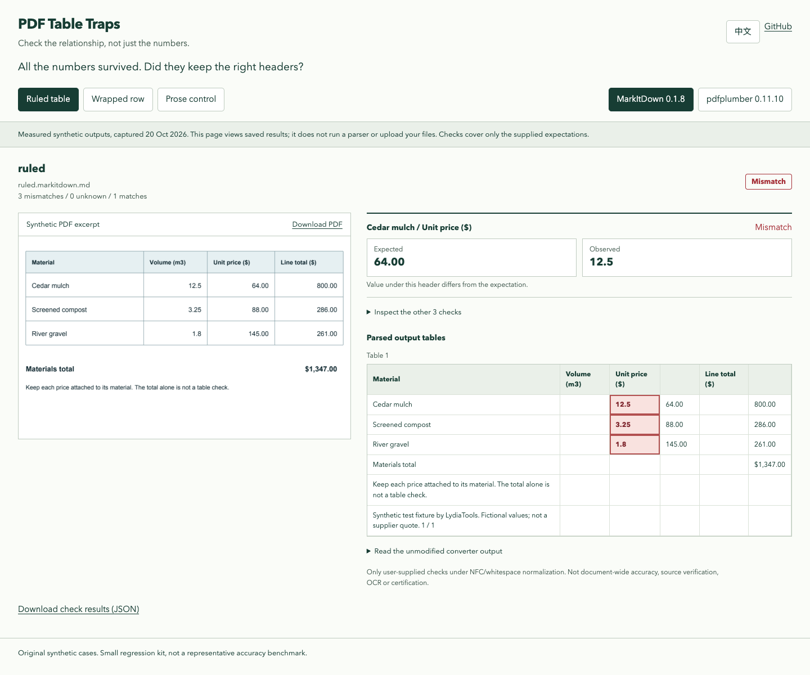

# PDF Table Traps

**All the numbers survived. The unit prices didn't stay under the right header.**

Three measured original PDFs, explicit row-and-column checks, and outputs you can reproduce before trusting a PDF-to-Markdown pipeline.

[Try your own output](https://lydiatools.github.io/pdf-table-traps/try.html) · [See the measured reports](https://lydiatools.github.io/pdf-table-traps/) · [中文](README.zh-CN.md) · [Download latest release](https://github.com/LydiaTools/pdf-table-traps/releases/latest) · [What was tested](docs/VALIDATION.md)



I wanted a smaller question than “which parser is best?”: **does this particular value still belong to this particular row and header?** A neat preview and a successful conversion don't answer it.

In the committed ruled-table sample, MarkItDown **0.1.8**, with local defaults and plugins disabled, retains `64.00` somewhere in its output. But the cell under `Unit price ($)` for `Cedar mulch` contains `12.5`. The source price is `64.00`.

That's one measured synthetic case, not a claim about every document or parser version. The full source, output, rules and hashes are included.

## What's here

- **3 original PDF fixtures:** a ruled table, a wrapped row without borders, and prose that should remain prose.
- **A separate two-page positional-text case:** [see why extracted character columns can drift](docs/POSITIONAL_COLUMNS.md) even when PDF coordinates match. This is not part of the six measured reports or the v0.1.0 ZIP.
- **2 measured local extraction paths:** MarkItDown 0.1.8 and pdfplumber 0.11.10 defaults; six saved reports.
- **An additional pinned integration:** pdf-inspector 1.25.2 on the same PDFs, with raw outputs and a reproducible CLI example. [Run it](docs/PDF_INSPECTOR.md).
- **Keyed cell assertions:** match an exact row label and column header, then compare the value. Finding a number elsewhere doesn't pass.
- **Optional positioned-text extraction:** specify page region and column edges to extract simple, single-line rows into per-page JSON tables, with page/row evidence. [Try the original two-page example](docs/POSITIONAL_COLUMNS.md#try-positioned-extraction).
- **Explicit uncertainty:** missing or ambiguous headers/rows, raw HTML tables and image cells need review.
- **CLI + JSON + standalone HTML reports.** Inspect saved outputs without a converter, model key or server.
- **A browser-only cell checker.** Paste Markdown output and compare one row/header/value against a value you verified in the source. It checks in the tab; it does not parse PDFs or upload text.
- **English/Chinese labels.** The measured report page shows saved results; the checker is a separate page.

## Try a known failure

Python **3.10+**. From a checkout:

```sh
git clone https://github.com/LydiaTools/pdf-table-traps.git
cd pdf-table-traps
python -m venv .venv
# macOS / Linux:
source .venv/bin/activate
# Windows PowerShell, use instead:
# .venv\Scripts\Activate.ps1
python -m pip install -r requirements.txt

python -m table_traps check \
  --input measured/ruled.markitdown.md \
  --rules cases/ruled.json \
  --json artifacts/failure.json \
  --html artifacts/failure.html
```

**Expected:** exit `1`, with three cell mismatches. That's the trap working, not an installation failure. Open `artifacts/failure.html` to inspect the exact values. Output files must be new files; existing reports and inputs are never overwritten.

The equivalent correct table, extracted by pdfplumber in this sample, is a positive control:

```sh
python -m table_traps check --input measured/ruled.pdfplumber.json --format tables-json --rules cases/ruled.json
```

**Expected:** exit `0`, four supplied checks match. This does not verify the rest of the document.

The commands use shell continuations for macOS/Linux. In PowerShell, put each command on one line; the single-line control above works as written.

## Check your own output

Create a small rule file from values you have checked against your source:

```json
{
  "version": 1,
  "name": "My critical price",
  "checks": [
    {
      "id": "cedar-price",
      "kind": "cell",
      "table": 1,
      "row_key": "Material",
      "row": "Cedar mulch",
      "column": "Unit price ($)",
      "equals": "64.00"
    }
  ]
}
```

```sh
python -m table_traps check --input your-output.md --rules your-rules.json
```

`table` is 1-based. The first row supplies column headers. Row labels are matched by the `row_key` column; changing row order is fine, duplicate labels are ambiguous. `table_count` checks can assert the number of supported tables, including zero.

Normalization is deliberately narrow: Unicode NFC and collapsed whitespace. Bold/code formatting is removed by the Markdown parser. `64.00`, `64`, `$64.00`, `064.00` and `64,00` are different strings. Units, signs, decimal formatting, leading zeros and letter case are not guessed or coerced.

Supported inputs:

- GFM pipe tables, including escaped pipes. Tables in fenced code blocks are ignored.
- `--format tables-json`: `{"tables": [[["Material", "Price"], ["Cedar", "64.00"]]]}`. Cells are strings or null; numeric JSON cells are rejected because formatting evidence would already be lost.

Raw HTML tables, image-based cells and unsupported inline HTML produce `unknown`, rather than silently passing an empty parse. A `<br>` inside a Markdown cell becomes whitespace. Empty Markdown never passes. Input/rule files are limited to 2 MiB; additional bounded limits are in [the checker](table_traps/core.py).

| Exit | Meaning |
| ---: | --- |
| `0` | All supplied checks match |
| `1` | At least one confirmed check mismatch; there may also be unknowns |
| `2` | No confirmed mismatch, but at least one check is unknown |
| `3` | Invalid input, arguments, dependency or output error |

In CI, accept only `0`. Do not turn unknowns into success. Reports contain the inspected values: review them before sharing private inputs.

## Reproduce the converter measurements

This is optional. The checker itself needs only `requirements.txt`.

```sh
python -m pip install -r requirements-validation.lock
python -m scripts.run_converters --output artifacts/my-run
```

The runner reads the three committed PDFs, uses local defaults, disables MarkItDown plugins, and writes raw outputs, checks, versions and SHA-256 hashes. No LLM client, credentials or hosted API is supplied. The MarkItDown installation includes Magika's local file-type classifier; this is not a claim that every dependency is model-free.

| Original case | MarkItDown 0.1.8 checks | pdfplumber 0.11.10 checks |
| --- | --- | --- |
| Ruled table | Mismatch: values under the wrong headers | Supplied checks match |
| Wrapped row, no borders | Mismatch plus a row requiring review | No table extracted; count mismatches |
| Prose control | Zero-table check matches | Zero-table check matches |

These are **three small synthetic cases**, not a representative benchmark, accuracy ranking or evaluation of OCR, scans, tuned settings, plugins or paid services. Both paths have limitations. A matched prose table-count check says nothing about prose transcription accuracy. [Run evidence](measured/run.json)

### Another local engine, the same checks

[pdf-inspector](https://github.com/firecrawl/pdf-inspector) already provides local PDF parsing and table detection. We measured its pinned **1.25.2** `process_pdf` path separately: the supplied checks match for the ruled table; the borderless table has **three cell mismatches**; the prose zero-table check matches. This is not a ranking. [Reproduce the integration and inspect the raw outputs](docs/PDF_INSPECTOR.md). These additional files are in the current source checkout; the six-panel viewer and fixed v0.1.0 ZIP retain the original two-path measurements.

## Why another repository?

[OmniDocBench](https://github.com/opendatalab/OmniDocBench) provides broad document-parsing evaluation. [ParseArena](https://github.com/shubham23471/parsearena) provides a broader visual parser-comparison workspace. Use them when that is your task.

This kit is intentionally smaller: original shareable PDFs, a few critical semantic pairs and a CLI that can fail your own regression test. It doesn't replace those projects, perform OCR, fix conversions or independently discover the truth in a PDF. You supply the expected values and scope.

The problem is visible in public reports such as MarkItDown [#41](https://github.com/microsoft/markitdown/issues/41), [#293](https://github.com/microsoft/markitdown/issues/293) and [#2336](https://github.com/microsoft/markitdown/issues/2336). We wrote our own fixtures and checker; no user-uploaded documents or upstream source were copied. This is an independent project, without vendor affiliation or endorsement.

## Development

```sh
python -m unittest discover -s tests -v
# Optional observed-outcome smoke test; success means the six recorded outcomes
# reproduced, not that every converter check passed:
python -m scripts.run_converters --output artifacts/smoke --expect-observed
```

Source-PDF generators, provenance and validation notes are in [`scripts/`](scripts/) and [`docs/VALIDATION.md`](docs/VALIDATION.md). Contributions should include a reproducible, lawfully shareable input and explicit expectations. [Contributing](CONTRIBUTING.md)

If this catches a regression in your pipeline, a small reproducible case is the most useful feedback. Star the repository if you want to keep the traps for your next parser upgrade.

MIT © LydiaTools. Fixtures, checker and report design are original. Dependencies retain their own licenses; see [third-party notices](THIRD_PARTY.md).
