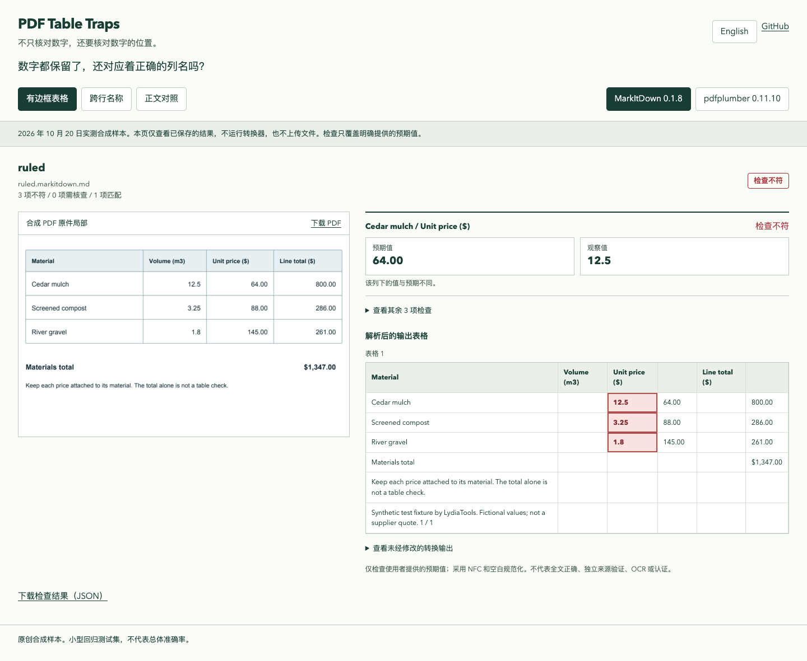

# PDF Table Traps · PDF 表格防错测试集

**数字一个没少，单价却跑到了错误的列里。**

3 份原创 PDF、明确到行和列的预期值，以及可以复跑的转换结果。先验证关键值还对应谁，再把 Markdown 送进 AI、搜索或数据处理流程。

[查看真实结果](https://lydiatools.github.io/pdf-table-traps/)（右上角切换中文） · [English](README.md) · [下载 v0.1.0](https://github.com/LydiaTools/pdf-table-traps/releases/tag/v0.1.0) · [验证范围](docs/VALIDATION.md)



我想解决一个具体问题：转换后的表格看着很整齐，数字也都还在，但某个值是否仍属于原来的材料、原来的列？

在本仓库有边框的合成样本中，MarkItDown **0.1.8** 默认本地转换后，`Cedar mulch` 的 `Unit price ($)` 列出现了数量 `12.5`，原件单价则是 `64.00`。这是一份明确版本、明确输入的实测，不代表所有 PDF 或所有版本都有相同表现。

## 能做什么

- 3 份原创样本：有边框表格、名称跨行的无边框表格、不应变成表格的正文。
- 2 条默认本地提取路径、6 份实测报告，保留原件、输出、版本与哈希。
- 按“行标识 + 列名”检查值；数字出现在别处不能冒充检查通过。
- 缺行、重复名称、缺列、歧义或不支持的结构会显示需要核查。
- 命令行、JSON 与独立 HTML 报告；检查已保存输出不需要转换器、模型密钥或服务器。
- 中英文报告标签。在线页面只查看已保存结果，不是实时转换器。

## 先体验一个应该失败的检查

需要 Python **3.10+**。克隆后在仓库根目录执行：

```sh
git clone https://github.com/LydiaTools/pdf-table-traps.git
cd pdf-table-traps
python -m venv .venv
# macOS / Linux:
source .venv/bin/activate
# Windows PowerShell 则使用：
# .venv\Scripts\Activate.ps1
python -m pip install -r requirements.txt
python -m table_traps check --input measured/ruled.markitdown.md --rules cases/ruled.json --json artifacts/failure.json --html artifacts/failure.html
```

预期退出码 **1**，发现 3 个单元格不符。这是测试抓到了问题，不是安装失败。打开生成的 HTML 可看预期值、观察值与对应表格。输出必须使用新文件名，不覆盖输入或已有报告。

同一份有边框样本的 pdfplumber 默认提取可作正确对照：

```sh
python -m table_traps check --input measured/ruled.pdfplumber.json --format tables-json --rules cases/ruled.json
```

预期退出码 **0**，表示明确给出的 4 项检查匹配，不表示全文正确。

## 检查自己的结果

先对照原件确认关键值，再写规则。例如：

```json
{
  "version": 1,
  "name": "关键单价",
  "checks": [
    {"id": "cedar-price", "kind": "cell", "table": 1,
     "row_key": "Material", "row": "Cedar mulch",
     "column": "Unit price ($)", "equals": "64.00"}
  ]
}
```

```sh
python -m table_traps check --input your-output.md --rules your-rules.json
```

表格编号从 1 开始；第一行为列名。按指定的行标识列匹配，允许行顺序改变；重复名称不能自动选一个。另有 `table_count` 检查，可确认表格数量，包括 0。

只做 NFC 和空白规范化，不猜数值含义：`64.00`、`64`、`$64.00`、`064.00`、`64,00` 都不同。Markdown 的加粗、行内代码不影响文字匹配；单位、符号、大小写和前导零保留。

支持 GFM 管道表格（包含转义竖线）与明确的矩阵 JSON：`{"tables": [[["材料", "单价"], ["松木", "64.00"]]]}`，后者加 `--format tables-json`。JSON 单元格必须是字符串或 null，数值类型会丢失格式证据，因此拒绝。

HTML 表格、图片单元格及不支持的行内 HTML 显示 unknown；Markdown 单元格中的 `<br>` 视为空白。代码块里的伪表格不计入。空 Markdown 不会通过。输入/规则每份不超过 2 MiB，另有行列及检查数量限制。

| 退出码 | 含义 |
| ---: | --- |
| 0 | 所有明确给出的检查匹配 |
| 1 | 至少一项确认不符，也可能同时存在 unknown |
| 2 | 没有确认不符，但存在无法判断项 |
| 3 | 参数、输入、依赖或输出错误 |

CI 只接受 0。报告包含被检查的值，分享私人文件结果前自行核对公开范围。

## 复跑实测

```sh
python -m pip install -r requirements-validation.lock
python -m scripts.run_converters --output artifacts/my-run
```

读取已提交的 3 份 PDF，使用默认本地配置，禁用 MarkItDown 插件，不提供 LLM 客户端、凭据或远端 API。安装的 MarkItDown 包含 Magika 本地文件类型分类器，不能因此说所有依赖都不含模型。检查器本身只需基础依赖。

| 样本 | MarkItDown 0.1.8 | pdfplumber 0.11.10 |
| --- | --- | --- |
| 有边框表格 | 数值与列名对应不符 | 给出的检查匹配 |
| 名称跨行、无边框 | 存在不符与需核查项 | 未提取到表格，数量不符 |
| 正文对照 | 零表格检查匹配 | 零表格检查匹配 |

这不是总体准确率或引擎排名，不覆盖扫描件、OCR、调参、插件或付费服务。正文对照通过只说明表格数为 0，不证明正文逐字正确。[实测记录](measured/run.json)

## 与现有项目的关系

[OmniDocBench](https://github.com/opendatalab/OmniDocBench) 做广泛文档评测；[ParseArena](https://github.com/shubham23471/parsearena) 提供更完整的解析器对比工作区。本项目专注少量可分享样本和关键对应关系的回归检查，不替代它们，不做 OCR、自动纠错或独立来源认证。

问题线索来自公开的 MarkItDown [#41](https://github.com/microsoft/markitdown/issues/41)、[#293](https://github.com/microsoft/markitdown/issues/293)、[#2336](https://github.com/microsoft/markitdown/issues/2336)。样本与检查器独立编写，没有复制用户上传文档或上游源码；与厂商无隶属或背书关系。

MIT 开源。欢迎提供可复现、具有公开授权的样本与明确预期值。如果它帮助你避免一次解析回归，可以 Star 留作下次升级前检查使用。
