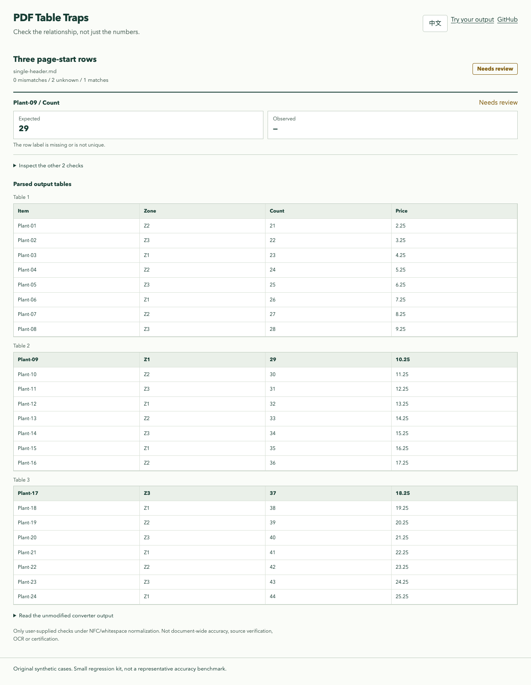

# 每个名称都还在，但两行变成了表头

[English](CONTINUATION.md) · [只在首页写表头的报告](https://lydiatools.github.io/pdf-table-traps/cases/continuation/single-report.html) · [每页重复表头的对照报告](https://lydiatools.github.io/pdf-table-traps/cases/continuation/repeat-report.html)

转换成功、文字一个没少，表格含义仍可能发生变化。这个案例是一份虚构的苗圃库存：3 页、共 24 行，每页 8 行。两份原创 PDF 内容相同，一份只在第一页写 `Item / Zone / Count / Price` 表头，另一份每页重复表头。

2026-11-01，我们用本机 **firecrawl-anydoc 0.2.4** 的 Python `to_markdown` 默认配置转换。只在首页写表头的结果里，24 个名称作为文字都能找到，但 `Plant-09` 和 `Plant-17` 被当作两个新 Markdown 表格的表头，而不是数据行；每页重复表头的对照结果中，24 行都是同一 Markdown 表格的数据行。另用 pypdf 6.1.1 独立读取原 PDF，核对每页应有的 8 个名称均存在。

我们给检查器提供了[3 条预期值](cases/continuation/rules.json)：核对第一张表里 `Plant-01`、`Plant-09` 和 `Plant-17` 的 `Count`。只在首页写表头的输出得到 **1 项匹配、2 项需核查**（退出码 2），后两行在第一张表中找不到；对照输出得到 **3 项匹配**（退出码 0）。“需核查”表示无法验证所给关系，并不自动说明原因，也不能找出所有受影响的行。仍需对照原件和全部输出表格。



*原创虚构样本的实际报告截图；完整表格和检查结果可在上方报告中查看。*

相关[上游报告](https://github.com/firecrawl/anydoc/issues/214)描述的是另一份跨页样本中的首行被省略；其关联的 [pdf-inspector 修复](https://github.com/firecrawl/pdf-inspector/pull/648)在 2026-11-01 核查时仍待审。我们独立生成的样本观察到的是另一种输出：名称仍在，但被当作表头。我们没有测试该修复，也不能推断它能解决本例。这是小范围合成对照，不代表其他 PDF 版式的总体表现。

## 复现

在仓库根目录使用 Python 3.10+ 和干净环境：

```sh
python -m pip install -r requirements.txt 'reportlab==4.4.9' 'firecrawl-anydoc==0.2.4'
python docs/cases/continuation/generate.py --output /tmp/continuation-example
python -m table_traps check --input /tmp/continuation-example/single-header.md --rules /tmp/continuation-example/rules.json
python -m table_traps check --input /tmp/continuation-example/repeat-header.md --rules /tmp/continuation-example/rules.json
```

请指定**不存在的输出目录**，脚本不会覆盖已有目录。第一条检查预期退出码为 2，第二条为 0；Windows 可将 `/tmp/continuation-example` 换成新的本机路径。仓库保留了[原创 PDF、实测 Markdown、规则和 JSON／HTML 报告](cases/continuation/)，不涉及私人文件或托管转换；PDF 哈希见 [SHA256SUMS](cases/continuation/SHA256SUMS.txt)。案例在 v0.2.0 预览版之后加入 main，不包含在该 ZIP 中。
